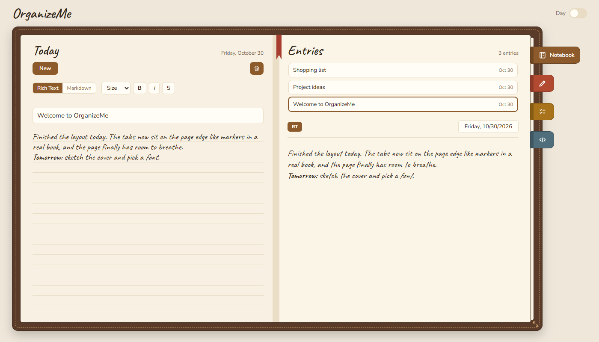
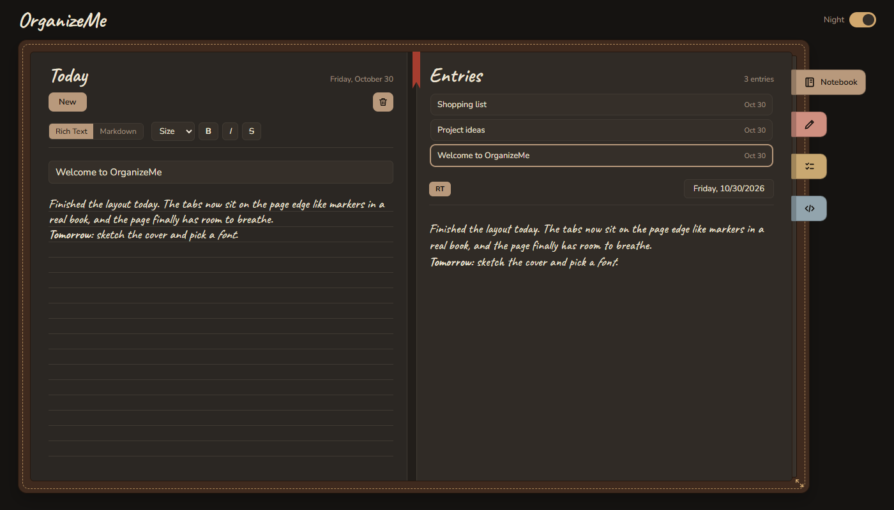
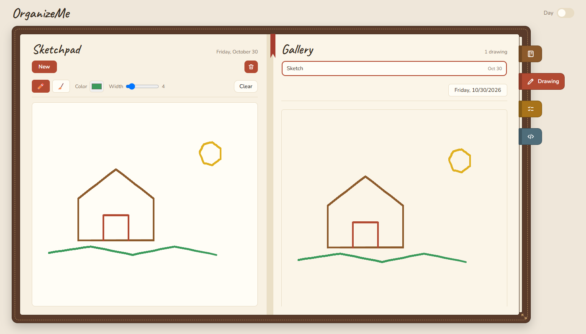
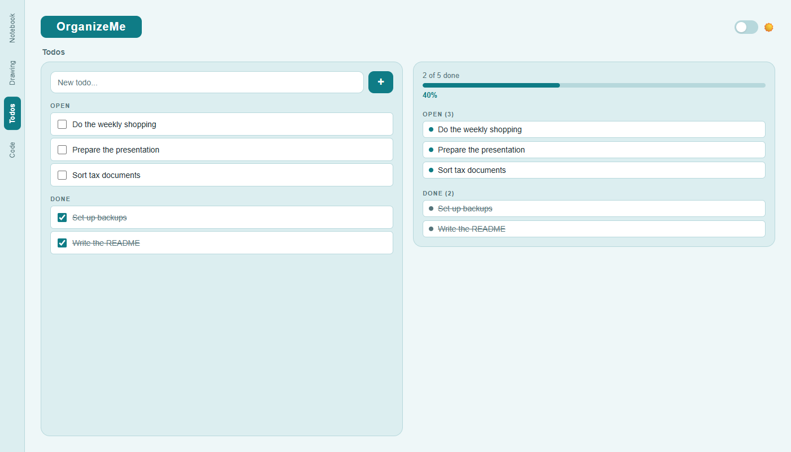
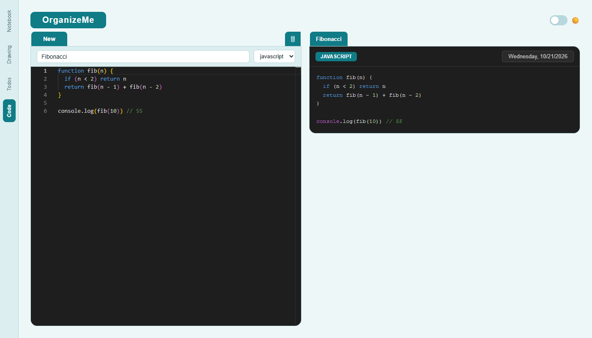

# OrganizeMe


A personal organizer as a local web app with four modules:

| Module | Description |
|---|---|
| **Notebook** | Entries as rich text (TipTap) or Markdown, with live preview |
| **Drawing** | Canvas with pen, eraser, color, and stroke width |
| **Todos** | Open and completed tasks with a progress indicator |
| **Code** | Snippets with the Monaco editor and syntax highlighting (highlight.js) |

It also includes a light/dark mode (petrol color scheme) and a draggable divider between the editor and the preview.

## Screenshots

| Notebook | Notebook (dark) |
|---|---|
|  |  |

| Drawing | Todos |
|---|---|
|  |  |

| Code |
|---|
|  |

## Project structure

```
Organizer/
├── backend/     Express API with SQLite (entries.db)
├── docs/        Screenshots for the README
└── frontend/    Frontend (Vue 3, Vite, Pinia)
    └── src/
        ├── App.vue
        ├── config.js          Backend API address
        ├── components/        Shared components (TabBar)
        ├── utils/             Shared helpers (debounce)
        └── modules/
            ├── entries/       Notebook – each module: components, services, stores
            ├── drawing/       Drawing
            ├── todo/          Todos
            └── code/          Code snippets
```

Each module separates the UI (`components`), API access (`services`), and state (`stores`, Pinia). Changes are saved automatically (debounced per item).

## Requirements

- Node.js `^20.19.0` or `>=22.12.0`

## Installation

```bash
cd backend
npm install
```

```bash
cd frontend
npm install
```

## Running

Backend (default port **3001**):

```bash
cd backend
npm start
```

Frontend (development server, usually http://localhost:5173):

```bash
cd frontend
npm run dev
```

Vite prints the exact address in the terminal.

### Changing the port

The backend reads the environment variables `PORT` and `DB_PATH` (path of the SQLite file). The frontend's backend address is defined in `frontend/src/config.js` and can be overridden with `VITE_API_BASE`, for example in `frontend/.env.local`:

```
VITE_API_BASE=http://localhost:4000
```

## Production build

```bash
cd frontend
npm run build
npm run preview
```

The backend must keep running.

## API

Every resource supports `GET /<name>`, `POST /<name>`, `PUT /<name>/:id`, and `DELETE /<name>/:id`.

| Resource | Fields |
|---|---|
| `/entries` | `title`, `content`, `mode` (`richtext` or `markdown`) |
| `/drawings` | `title`, `data` (PNG as a data URL) |
| `/todos` | `title`, `done` |
| `/snippets` | `title`, `code`, `language` |

## Data

By default, data is stored in `backend/entries.db` (SQLite, WAL mode), which `.gitignore` excludes from Git. The file is created on first start. To back it up, copy it together with `entries.db-wal` and `entries.db-shm` while the backend is stopped.

## Customizing colors

All colors are CSS variables in `frontend/src/App.vue` (`:root` for light, `.dark` for dark). `--on-accent` is the text color on accent-colored surfaces.

## Notes

- The app is intended for local use. The API has no authentication.
- Markdown content is rendered unfiltered.
