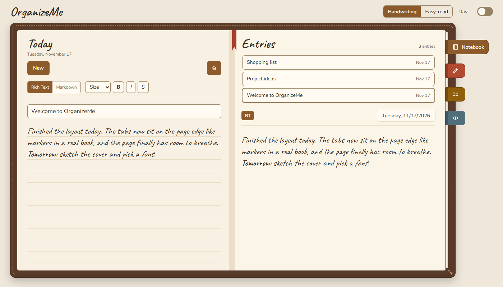
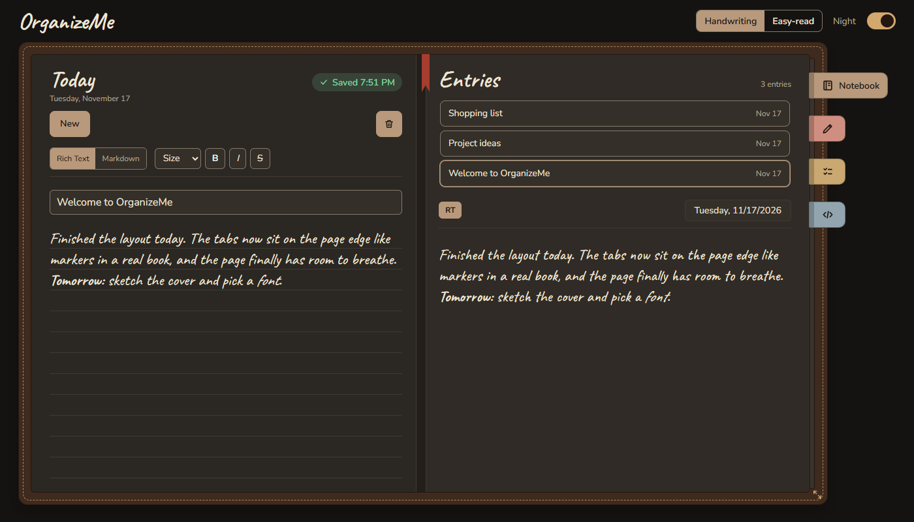
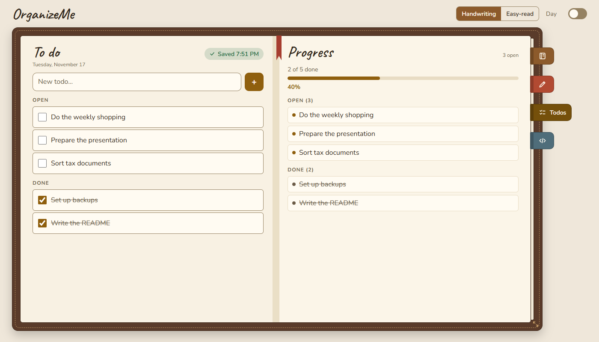
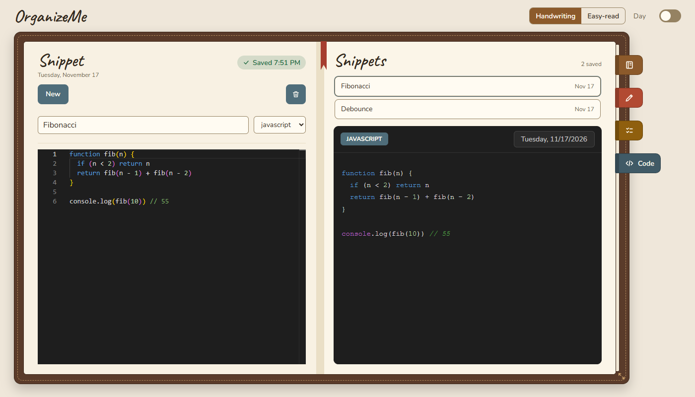
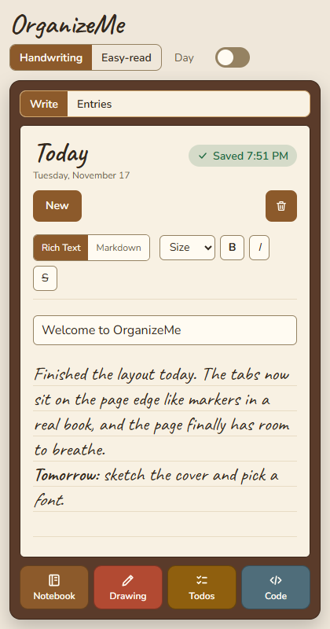

# OrganizeMe


OrganizeMe is a personal digital diary that runs on your own computer. Notes, drawings, todos, and code snippets live in one place, laid out as an open leather-bound book with one tab per tool. Everything is stored in a local SQLite file, with no account and no cloud.

**Status:** experimental personal project, in active development.



## Features

- **Four tools, one tab each:** notebook, drawing, todos, and code snippets. The page color follows the active tool.
- **Notebook:** write in rich text (TipTap) or Markdown. The right page shows a live preview.
- **Drawing:** canvas with pen, eraser, color, and stroke width. Drawings are stored as PNG.
- **Todos:** open and done lists with a progress bar.
- **Code:** snippets in the Monaco editor with syntax highlighting for ten languages.
- **Autosave with feedback:** a status next to each page title shows "Saving…", "Saved 7:47 PM", or "Couldn't save" with a retry button.
- **Day and night mode**, and a choice between handwriting (Caveat) and an easy-read font for entries.
- **Resizable book:** drag the bottom right corner. On screens narrower than 900 px it shows one page at a time.
- **Keyboard shortcuts** for switching tools and creating items.
- **Accessibility:** text meets WCAG AA contrast (4.5 : 1) in day and night mode, controls show a focus ring, and animations respect `prefers-reduced-motion`.

| Notebook, night | Todos |
|---|---|
|  |  |

| Code | Narrow screen |
|---|---|
|  |  |

## Requirements

- [Node.js](https://nodejs.org/) 20.19 or newer, or 22.12 or newer (required by Vite 8). Tested with Node 24.
- npm, which comes with Node.js.

No external services or API keys are needed.

## Installation

```bash
git clone https://github.com/TranceMeli/OrganizeMe.git
cd OrganizeMe

cd backend
npm install
cd ../frontend
npm install
```

If the backend stops with `Could not locate the bindings file`, the native SQLite module was not built. Run `npm rebuild sqlite3` in `backend`. Recent npm versions block install scripts by default; `backend/package.json` already allows the one for `sqlite3`.

## Quick start

Run the backend and the frontend in two terminals.

```bash
cd backend
npm start
```

```bash
cd frontend
npm run dev
```

Open the address that Vite prints, usually <http://localhost:5173>. The backend listens on <http://localhost:3001>.

On the first start the backend creates `backend/entries.db`. Click **New entry** to write your first page.

## Usage

### Keyboard shortcuts

| Keys | Action |
|---|---|
| `Alt` + `1` to `4` | Switch to notebook, drawing, todos, or code |
| `Alt` + `N` | Create a new item in the current tool (in Todos: jump to the new-todo field) |
| `Esc` | Close the confirmation dialog |

Ctrl shortcuts are not used because browsers reserve `Ctrl` + digits and `Ctrl` + `N`.

### Talking to the API directly

Every collection (`entries`, `drawings`, `todos`, `snippets`) supports `GET /<name>`, `POST /<name>`, `PUT /<name>/:id`, and `DELETE /<name>/:id`.

```bash
curl -X POST http://localhost:3001/todos \
  -H "Content-Type: application/json" \
  -d '{"title": "Water the plants"}'
```

The response is the stored todo:

```json
{ "id": "…", "title": "Water the plants", "done": 0, "created_at": "2026-11-17 18:47:03" }
```

| Collection | Fields |
|---|---|
| `entries` | `title`, `content`, `mode` (`richtext` or `markdown`) |
| `drawings` | `title`, `data` (PNG as a data URL) |
| `todos` | `title`, `done` |
| `snippets` | `title`, `code`, `language` |

## Configuration

All settings are optional.

| Variable | Used by | Description | Default |
|---|---|---|---|
| `PORT` | backend | Port of the API | `3001` |
| `DB_PATH` | backend | Location of the SQLite file | `backend/entries.db` |
| `VITE_API_BASE` | frontend | Address of the API | `http://localhost:3001` |

Set `VITE_API_BASE` in `frontend/.env.local` when the backend runs on another port:

```bash
VITE_API_BASE=http://localhost:4000
```

The UI preferences (book size, active tool, day or night, entry font) are stored in your browser's local storage.

## Development

```bash
cd frontend
npm run build     # production build, also a quick check that everything compiles
npm run preview   # serve the production build; the backend must be running
```

The project has no automated tests and no linter yet. See [CONTRIBUTING.md](CONTRIBUTING.md) for how to check a change by hand.

### Project structure

```
OrganizeMe/
├── backend/           Express API with SQLite
├── docs/screenshots/  Images used in this README
└── frontend/          Vue 3, Vite, Pinia
    └── src/
        ├── App.vue         Book layout, tabs, shortcuts, design tokens
        ├── components/     Shared UI: dialog, save status, item list, empty state
        ├── composables/    Save status and dialog state
        ├── modules/        One folder per tool: components, services, stores
        ├── styles/         book.css – cover, pages, tabs
        └── utils/          API client, debounce, date formatting
```

### Backup

Stop the backend, then copy `backend/entries.db` together with `entries.db-wal` and `entries.db-shm` if they exist. The files are excluded from Git on purpose.

## Known limitations

- Single user. The API has no authentication, so run it only on a machine you trust.
- Markdown is rendered without sanitising, because only your own notes are shown. Add a sanitiser such as DOMPurify before exposing the app to other people.
- Switching an entry between rich text and Markdown starts it empty, because the two formats cannot be converted into each other.

## Contributing

Bug reports and ideas are welcome. Read [CONTRIBUTING.md](CONTRIBUTING.md) first.

## Help and support

Open an [issue](https://github.com/TranceMeli/OrganizeMe/issues) for questions, bugs, and feature requests.

## License

No license has been chosen yet, so all rights are reserved by default. Please open an issue before reusing the code.
